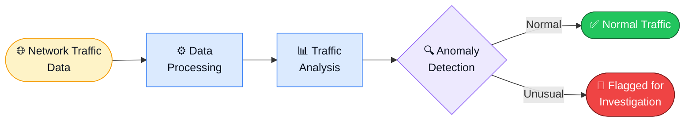
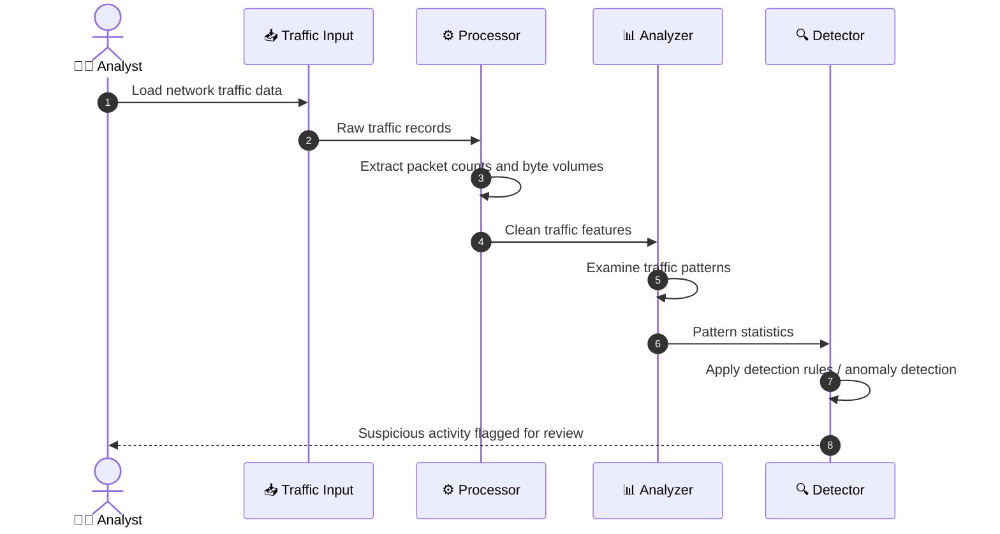
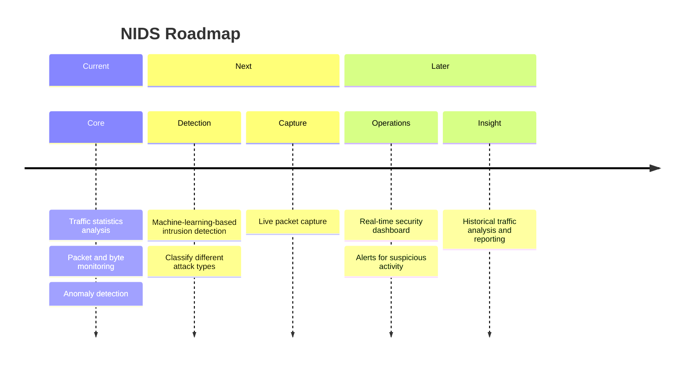

<div align="center">


<br/>

**A cybersecurity project that analyzes network traffic statistics, detects anomalies and flags suspicious activity that may indicate an intrusion.**

<br/>

[](https://www.python.org/)
[](#-overview)
[](#-overview)
[](#-how-it-works)
[](#-license)

<br/>

[](https://github.com/Lakshya0023/NETWORK-INTRUSION-AI-BASED-THREAT-DETECTION-SYSTEM)

<br/>

<a href="#-overview">Overview</a> &nbsp;·&nbsp;
<a href="#-features">Features</a> &nbsp;·&nbsp;
<a href="#-how-it-works">How It Works</a> &nbsp;·&nbsp;
<a href="#-quick-start">Quick Start</a> &nbsp;·&nbsp;
<a href="#-expected-output">Output</a> &nbsp;·&nbsp;
<a href="#-security--ethical-use">Ethics</a> &nbsp;·&nbsp;
<a href="#-roadmap">Roadmap</a>

</div>

<br/>

```text
 _   _ ___ ____  ____
| \ | |_ _|  _ \/ ___|
|  \| || || | | \___ \
| |\  || || |_| |___) |
|_| \_|___|____/|____/
```

> **NIDS** watches network traffic for patterns that do not look normal. It examines packet counts and byte volumes, flags unusual behaviour, and gives analysts a short list of records worth investigating.

<br/>

## ✦ At a Glance

<div align="center">

| 📦 **Packets** | 📊 **Bytes** | 🔍 **Anomalies** | 🚩 **Alerts** | 🛡️ **Purpose** |
|:---:|:---:|:---:|:---:|:---:|
| Counted and analyzed | Volume monitored | Unusual patterns found | Suspicious records flagged | Defensive security |

</div>

<br/>

## ✦ Overview

Networks carry a lot of traffic, and most of it is harmless. A small share of it is not: port scans, floods, data exfiltration and other probing show up as traffic that looks different from the normal baseline. NIDS looks for that difference.

It takes traffic data in, measures the things that matter (**packet counts** and **byte volumes**), and flags what stands out so a human can look closer.



<br/>

## ✦ Objectives

<div align="center">

| 👁️ Monitor | 🔎 Identify | 🚨 Detect | 📈 Analyze | 🧠 Inform |
|:---:|:---:|:---:|:---:|:---:|
| Watch network traffic | Find suspicious patterns and anomalies | Catch potential intrusions | Study packet counts and byte volumes | Give useful insight for security analysis |

</div>

<br/>

## ✦ Features

<div align="center">

| 📡 Traffic Analysis | 🔬 Detection | 🧾 Insight |
|:---|:---|:---|
| Examines network traffic statistics | Anomaly detection on traffic patterns | Helps users understand potential threats |
| Packet count monitoring | Flags suspicious activity | Highlights records for follow-up |
| Byte volume monitoring | Surfaces unusual behaviour | Supports security analysis |

</div>

<br/>

## ✦ How It Works



<div align="center">

| Step | Stage | What happens |
|:---:|:---|:---|
| ① | **Traffic Input** | Collect or load network traffic data |
| ② | **Data Processing** | Process packet counts, byte volumes and relevant traffic features |
| ③ | **Traffic Analysis** | Examine traffic patterns for unusual behaviour |
| ④ | **Intrusion Detection** | Apply detection rules or anomaly detection methods |
| ⑤ | **Results** | Flag suspicious activity for further investigation |

</div>

<br/>

## ✦ Tech Stack

<div align="center">

| Layer | Technology |
|:---|:---|
| 🐍 **Language** |  |
| 🌐 **Domain** | Network traffic analysis |
| ⚙️ **Processing** | Data processing of traffic statistics |
| 🔍 **Detection** | Anomaly detection techniques |

</div>

<br/>

## ✦ Quick Start

<details open>
<summary><b>1 · Clone the repository</b></summary>

<br/>

```bash
git clone https://github.com/Lakshya0023/NETWORK-INTRUSION-AI-BASED-THREAT-DETECTION-SYSTEM.git
cd NETWORK-INTRUSION-AI-BASED-THREAT-DETECTION-SYSTEM
```

</details>

<details open>
<summary><b>2 · Create a virtual environment</b></summary>

<br/>

```bash
python3 -m venv venv
```

Activate it:

```bash
# macOS / Linux
source venv/bin/activate

# Windows
venv\Scripts\activate
```

</details>

<details open>
<summary><b>3 · Install dependencies</b></summary>

<br/>

```bash
pip install -r requirements.txt
```

</details>

<details open>
<summary><b>4 · Run the project</b></summary>

<br/>

```bash
python3 main.py
```

> 💡 Replace `main.py` with your project's actual entry-point script.

</details>

<br/>

## ✦ Expected Output

The system can report:

<div align="center">

| 📦 Total packets analyzed | 📊 Total bytes processed | 🚩 Suspicious records | 🔍 Potential anomalies |
|:---:|:---:|:---:|:---:|
| How much traffic was examined | Overall traffic volume | Records flagged for review | Unusual patterns detected |

</div>

> Actual output depends on the dataset, detection rules and implementation.

<br/>

## ✦ Project Structure

```text
NETWORK-INTRUSION-AI-BASED-THREAT-DETECTION-SYSTEM/
│
├── data/                 # Network traffic datasets (if used)
├── src/                  # Source code
├── models/               # Detection models (if applicable)
├── main.py               # Main application entry point
├── requirements.txt      # Python dependencies
└── README.md             # Project documentation
```

> ✏️ Adjust folder and file names to match your actual repository.

<br/>

## ✦ Security & Ethical Use

<div align="center">

| ✅ Intended for | ⚠️ Remember |
|:---|:---|
| Educational purposes | Test only on networks and systems you **own** or have **explicit permission** to monitor |
| Defensive cybersecurity | Unusual traffic does **not always** mean an attack, so investigate flagged results further |

</div>

<br/>

## ✦ Roadmap



<div align="center">

| Status | Enhancement |
|:---:|:---|
| 🔲 | Integrate live packet capture |
| 🔲 | Add machine-learning-based intrusion detection |
| 🔲 | Build a real-time security dashboard |
| 🔲 | Generate alerts for suspicious network activity |
| 🔲 | Classify different types of network attacks |
| 🔲 | Add historical traffic analysis and reporting |

</div>

<br/>

## ✦ Contributing

Ideas, issues and pull requests are welcome.

1. Fork the repository
2. Create a feature branch: `git checkout -b feature/your-idea`
3. Commit your changes and push the branch
4. Open a pull request

<br/>

## ✦ License

Released under the **MIT License**.

<br/>

## ✦ Author

<div align="center">

**Lakshya**

Cybersecurity · Network Security · Python

[](https://github.com/Lakshya0023)

</div>

<br/>

<div align="center">

```text
CAPTURE  →  PROCESS  →  ANALYZE  →  DETECT  →  INVESTIGATE
```

### Watching the network so people don't have to

**Built with Python · Network Traffic Analysis · Anomaly Detection**

<br/>

[Source Code](https://github.com/Lakshya0023/NETWORK-INTRUSION-AI-BASED-THREAT-DETECTION-SYSTEM) &nbsp;·&nbsp; [Report an Issue](https://github.com/Lakshya0023/NETWORK-INTRUSION-AI-BASED-THREAT-DETECTION-SYSTEM/issues)


</div>
